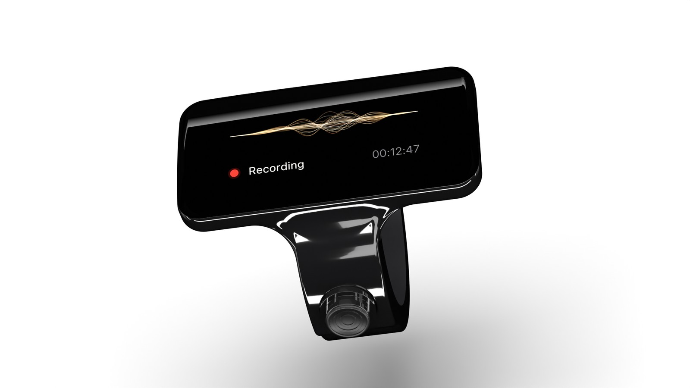
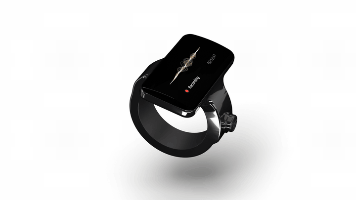
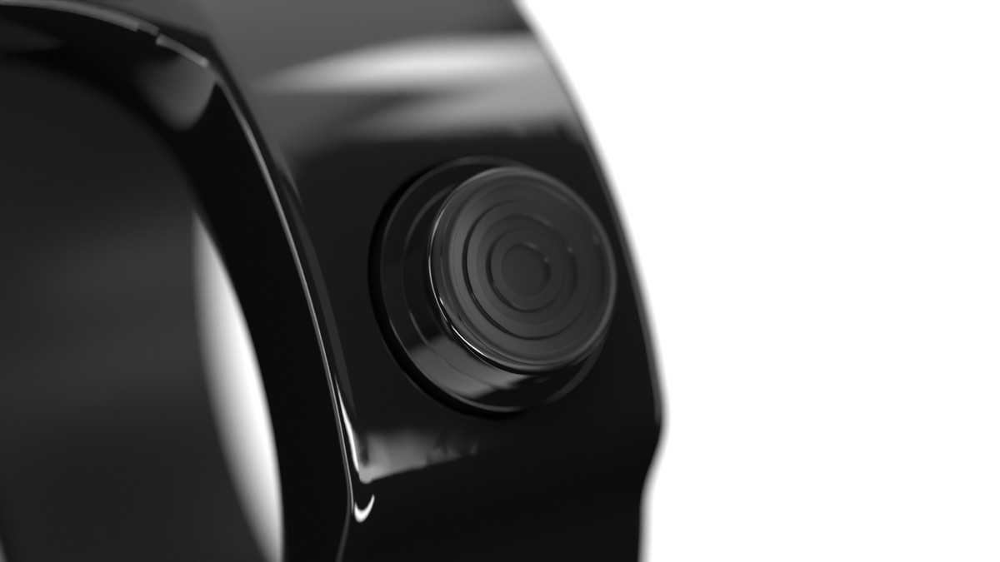
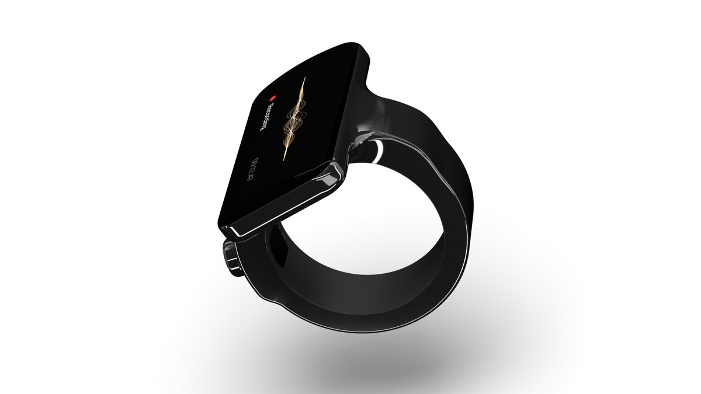
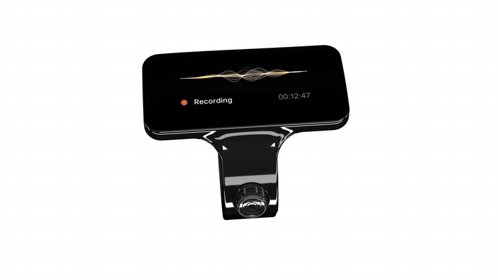
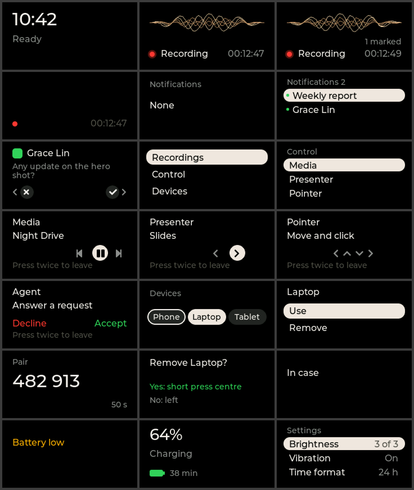
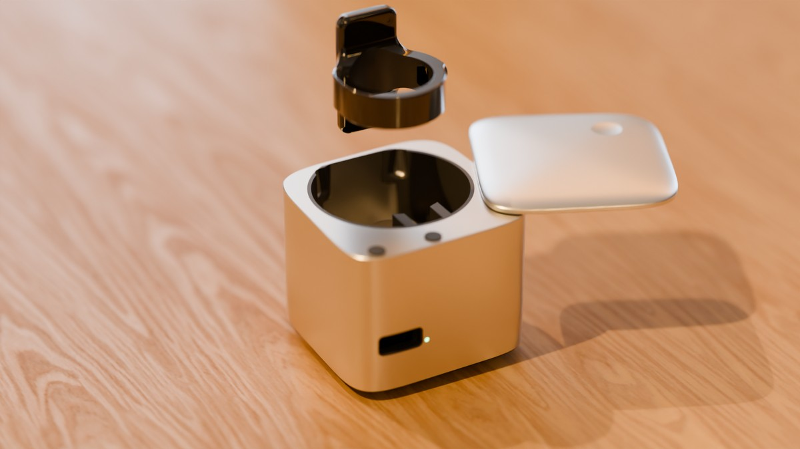
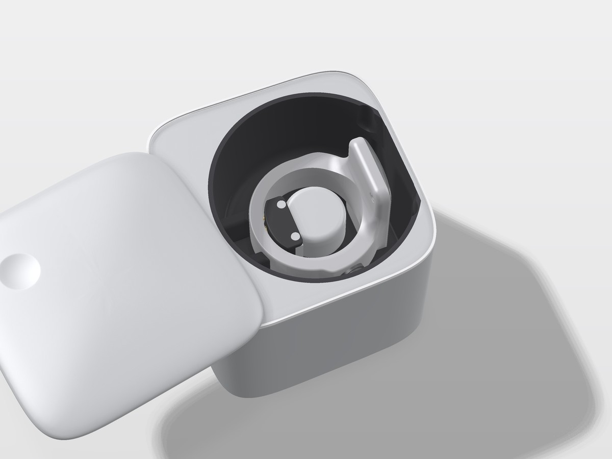

<h1 align="center">OpenRing</h1>

<p align="center">
  <b>An open-source ring that records your meetings.</b><br>
  One joystick, a small screen, two microphones and its own storage, in a ring you wear on your index finger.
</p>

<p align="center">
  
</p>

<p align="center">
  <a href="#what-it-is">What it is</a> ·
  <a href="#where-the-project-stands">Status</a> ·
  <a href="#inside-the-ring">Inside</a> ·
  <a href="#the-software">Software</a> ·
  <a href="#what-is-in-this-repository">Files</a> ·
  <a href="#check-it-yourself">Checks</a> ·
  <a href="#licence">Licence</a>
</p>

---

## What it is

OpenRing is the complete design of a meeting recorder that you wear as a ring:

- **Press and hold the joystick for one second** and the ring records. Hold again and it stops. Nothing else starts a recording: no voice trigger, no phone command, no always-on listening.
- **The screen shows that it records.** A red dot and a timer stay lit for the whole recording, so the people around you can see it.
- **The audio stays on the ring.** It is stored on the ring's own 4 GB memory and moves to your computer through the charging case over USB.
- **It also controls your devices.** Paired with up to three devices, the ring works as a Bluetooth keyboard, media remote and pointer, and it shows iPhone notifications.

Everything needed to build it is here: 3D models, wiring, parts lists, drawings, the assembly order, the behaviour specification and the ring's software with its tests.

<p align="center">
  
</p>

## Where the project stands

> **This is a design, not a product. No ring has been built yet.**
> Every claim below says how it was checked. Nothing here has run on real hardware.
> State of 13 November 2026: an intermediate release, pushed while the fixes below are in work.

| Part | State | How it was checked |
|---|---|---|
| Ring exterior, 7 sizes (US 7 to 13) | being rebuilt on the thin block (3.20 mm) for a flat cover glass over a custom full-face screen panel; a taller 4.17 mm exterior for a stock screen is kept as a fallback | 3D models per size, measured by script |
| Inside of the ring | designed for the thin block with a stock screen; the rebuild for the custom panel and the flat glass is in work | fit check per size on the earlier model |
| Charging case | designed; its fit to the ring with the flat glass is not redone yet | fit check against the earlier ring models |
| Circuit boards (17: the ring's main board, 14 band circuits for 7 sizes, 2 case boards) | **routed** | design rules check: 0 violations and 0 unconnected on each board |
| Wiring list (`design/wiring/product-wiring.csv`) | written: 66 conductors, each with both ends, its carrier and its cut length per size | a check compares the list with the boards and the netlists; an independent review found the list true (67 of 67 lines) |
| Joint table and build guide (`design/mfg/assembly/`) | written: 99 joints | **an independent review of 13 November failed the guide on 3 points, listed below; 1 is open** |
| Circuit simulation (`design/sim/circuit/`) | 13 tests pass | each test has a pass line written before the run and a faulty copy that must fail |
| Ring software: core, paired devices, control, iPhone services, screens, Android relay | written | simulated on the ring's chip model with real Bluetooth encryption |
| Ring software: recorder parts (microphones, storage, USB transfer, power) | written against simulated drivers | the full test run passes on the simulated board for the reviewed version; a second independent review passed it; the fixes of its minor findings are in this release, and their own full test run was still running when this was pushed |
| Ring software: the real ring's board files, the panel driver | **not written** | planned |
| A working ring | **does not exist** | needs a development kit bench first, see `design/bench/` |

An independent review found three faults that stop a build from the files. Two are fixed in the guide; the first is open. They are written up in `design/wiring/wiring-review-4.md`:

1. **The body files are behind.** The body drawings still show the earlier block, without the two side slits the ribbons pass through and without the pocket of the custom screen panel. Open.
2. **Two ground joints per ribbon cannot be told apart by a meter.** The decision is to treat them as a spare pair; the guide now says what its test proves. Fixed.
3. **No test proved the two thermistor joints of the case.** A resistance check is added to the case board's tests. Fixed.

Four values need a measurement on the first built ring: the antenna match, the accuracy of the 32 MHz clock, the case's input current while a ring charges, and USB through the case's spring pins (`design/ecad/risk-review.md`).

## How you use it

<table>
  <tr>
    <td width="50%"></td>
    <td width="50%"></td>
  </tr>
</table>

The ring has **one control**: a round five-way joystick on the side of the band, under your thumb.

| You do | The ring does |
|---|---|
| Hold the centre for 1 second | starts a recording; hold again to stop |
| Short press while recording | marks a highlight |
| Push up, down, left, right | moves through the menu |
| Open a control mode | sends keys to the active device: media, slides, pointer, or accept and decline |

A vibration motor confirms the start and the stop.

## Inside the ring

<p align="center">
  
</p>

| | |
|---|---|
| **Size** | block 29.3 x 14.75 x 3.85 mm on a band 8.0 mm wide and 2.6 mm thick |
| **Body** | titanium grade 5, gloss black |
| **Screen** | 0.95 inch AMOLED, 120 x 240 pixels, under a formed cover glass |
| **Main chip** | Nordic nRF54LM20A (Bluetooth LE) |
| **Power chip** | Nordic nPM1304 |
| **Microphones** | 2 x Knowles SPK0641HT4H-1, 16 kHz, 16 bit, two channels, stored raw |
| **Storage** | 4 GB, on the ring |
| **Battery** | a custom curved cell inside the band, 17.6 to 31.9 mAh depending on ring size |
| **Recording time** | 4.3 to 7.8 hours by ring size (calculated, not measured) |
| **Feedback** | vibration motor |
| **Charging** | 4 pads on the inside of the band, touched by 4 spring pins in the case |
| **Weight** | not known yet; body, joystick and motor alone come to 4.6 to 5.4 g |

The exploded view is an illustration from the project's own models. The reference is always the model and the parts list in `design/`.

## The screen

<p align="center">
  
</p>

These 21 pictures come from the ring's own screen code. The code draws each screen on a simulated display, and a test reads the picture back from the display memory and checks it. The pictures are in `design/software/os/screens/`.

**Limit:** no real panel has shown them. The driver for the ring's panel is not written, because no ready driver exists for that panel.

## The charging case

<table>
  <tr>
    <td width="50%"></td>
    <td width="50%"></td>
  </tr>
</table>

A soft cube of 45.4 x 45.9 x 41.4 mm with a lid that swivels aside. The ring sits around a centre post. Four spring pins on the post touch the pads inside the band. The case charges the ring from its own 700 mAh cell and moves the recordings to a computer over USB-C.

One post holds all seven ring sizes. The fit check places the real ring model of every size in the case and measures every pin against its pad.

## The software

The ring runs a small firmware on Zephyr and the nRF Connect SDK. It is written to be proven without hardware: every step ends with tests on a simulated ring chip, and with deliberately broken copies that must fail.

| Step | What it does | State |
|---|---|---|
| 1. Core | the state machine and the joystick gestures of the behaviour specification | done, tests pass |
| 2. Devices and control | passkey pairing, three paired devices, keyboard, media and pointer control | done, tests pass |
| 3. iPhone | notifications with their actions, track and media commands, time | done, tests pass |
| 4. Screens | the 21 screens, the menu, the notification list, the control and device screens | done, tests pass |
| 5. Android relay | a small service on the ring that takes notifications from a helper app, and the written specification for that app | done, tests pass |
| 6. Recorder | microphones, storage, USB transfer, power, factory tests, against simulated drivers | written and reviewed; the fixes of the last review are in, their full test run pending |
| 7. Board | the real ring's board files | not started |

What works per device, by design:

| Device | Control by the ring | Notifications on the ring |
|---|---|---|
| iPhone | yes | yes |
| Android | yes | yes on the ring side; needs a helper app on the phone (specified in `design/software/os/android-helper-spec.md`, not built) |
| Mac | yes | no supported way was found |

**Honest limit:** the tests use stand-in devices written for this project. Nothing has been tried against a real iPhone, Android phone or Mac.

## What is in this repository

| Folder | What it holds |
|---|---|
| `requirements.md` | what the ring must do, with every later change and its reason |
| `design/architecture.md` | the design record: every decision, in order |
| `design/bom.csv` | the ring's parts list, with maker part numbers |
| `design/ecad/` | wiring diagram, netlist and circuit board files (KiCad) |
| `design/wiring/` | every conductor of the product in one list, its drawing, the decisions and the independent wiring reviews |
| `design/sim/` | the circuit simulation bench |
| `design/mech/` | the inside model of the ring and its fit check |
| `design/look/` | the exterior model, one file per ring size |
| `design/mfg/` | maker files (STEP, STL), drawings, one specification page per custom part, the assembly order |
| `design/case/` | the charging case: model, parts list, wiring, fit check |
| `design/firmware.md` | the behaviour specification the software follows |
| `design/bench/` | the plan for a desk prototype from development kits |
| `design/review/` | three independent reviews of the design, with their findings |
| `firmware/` | the ring's software, its tests and the build scripts |
| `explorer/` | a browser app to look through the design |
| `LICENSES/`, `LICENSE.md`, `NOTICE.md` | the licences and the third-party notice |

Maker datasheets are not included. `design/datasheets/README.md` lists each bought part with its maker and part number.

## Check it yourself

The design ships with its own checks. Each one reads the design files and fails when they disagree with each other.

These run from this repository alone:

```sh
python3 design/tools/check_bom.py          # parts list against the wiring and the model
python3 design/mfg/tools/check_docs.py     # maker specification pages
python3 design/case/check_case_docs.py     # case documents
python3 tools/check_public.py              # this repository holds no private or third-party file
```

These four also read the makers' own datasheets, which are not in this repository (their makers own them). They stop with "cannot read" or "no file" until you download the documents listed in `design/datasheets/README.md` and put them where each check names them:

```sh
python3 design/ecad/ring/check_netlist.py         # wiring rules, against the makers' pin tables
python3 design/firmware-check.py                  # behaviour specification
python3 design/mfg/assembly/check_assembly.py     # assembly order and its citations
python3 design/bench/check_bench.py design/bench/bench-plan.md design/bom.csv
```

All seven passed on the full project before the maker documents were taken out for this release.

The 3D model checks (`design/mech/thin/check_thin.py`, `design/case/case_check.py`) need the Python package `build123d` and take 20 to 60 minutes each.

To build and test the software, read `firmware/README.md`. It needs Linux and Nordic's toolchain; the chip simulation does not run on macOS.

## What is not done

- The first fault above (the body files) is open.
- The inside model, the body maker files, the case fit and the pictures of this page still show the thin block with a stock screen under a formed glass (3.85 mm on this page's table). The design moves to a custom screen panel that fills the face, under a flat glass, on the same thin block. The requirement page for panel makers is `design/mfg/specs/screen-panel-custom.md`; no maker has answered.
- The main board as routed carries the screen connector and eight small parts on its screen face. In the thin block the connector must move to the under face; that routing is in work.
- No part has been ordered, measured or assembled.
- The spring pin of the case and the thin walls of its pin holder are not confirmed by a maker.
- Battery life, radio range, sound quality, water resistance and weight are calculated or unknown. None is measured.
- The software has no panel driver and no board files for the real ring yet. The Android helper app is specified and not built.

If you build any of it, measure something, or find a mistake, open an issue. That is why the design is public.

## Licence

OpenRing is open hardware and open software:

| What | Licence |
|---|---|
| Hardware design: 3D models, wiring, circuit board, parts lists, drawings | CERN-OHL-S 2.0 (share-alike) |
| Software: `firmware/`, `explorer/` and every script | Apache 2.0 |
| Documents and pictures | CC BY 4.0 |

The licence texts are in `LICENSES/`. Details per folder are in [LICENSE.md](LICENSE.md). Third-party software and parts keep their own licences, see [NOTICE.md](NOTICE.md).

## About the name

This project is not related to other projects with a similar name, among them the research app repository `thuhci/OpenRing` and the hardware project `stawiski/open-ring`.

## How this was made

The pictures on this page are rendered from the project's own 3D models. The design files, the checks and the software were produced with AI assistance and reviewed by independent AI reviewers; their reports are in `design/review/` and `firmware/docs/`. Treat every number as a design value until someone measures it.
